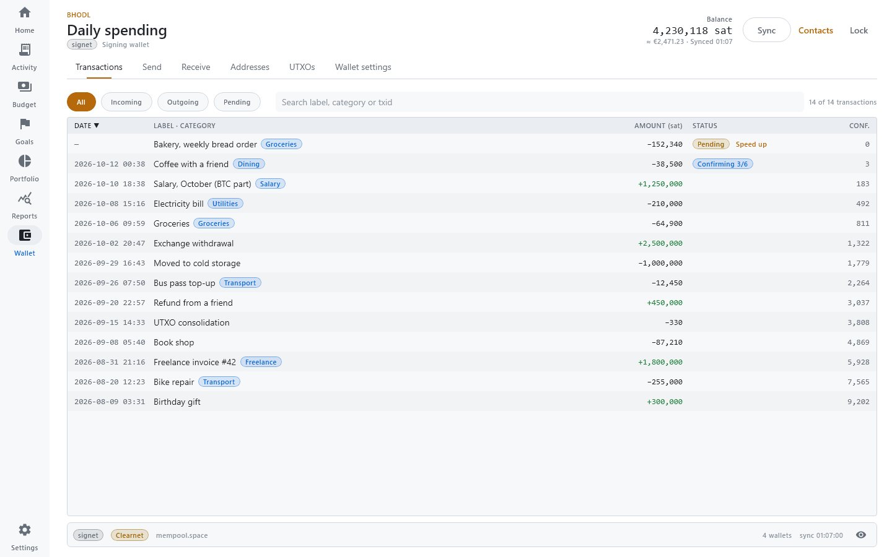
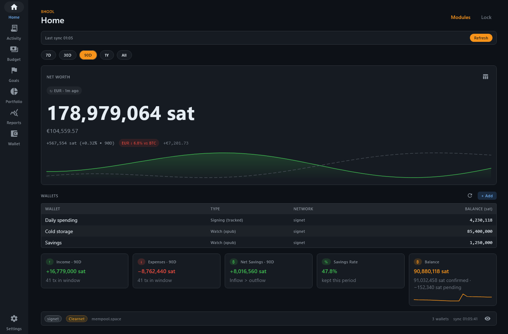
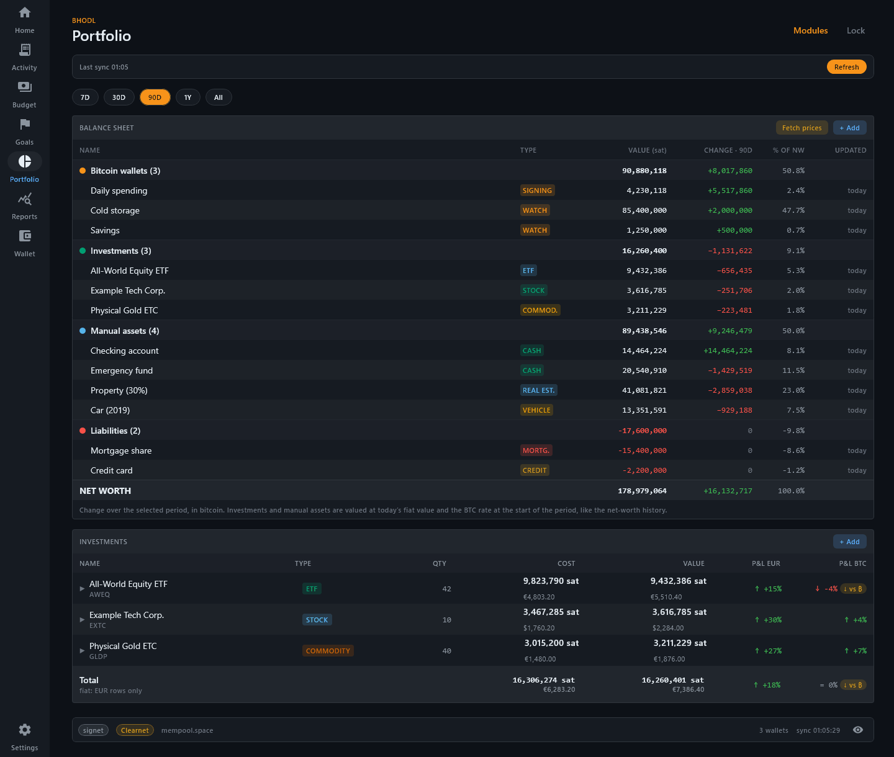
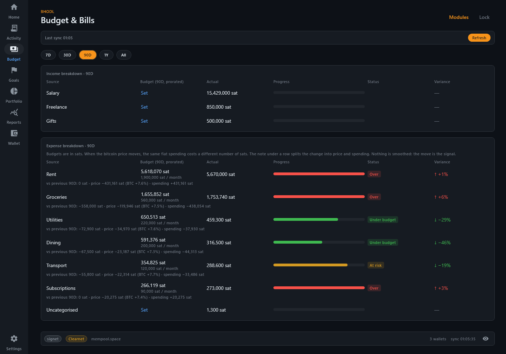

# BHODL

> A watch-only Bitcoin wallet with a net-worth and spending tracker built in, that counts in sats.

BHODL is a desktop app (Rust core + Kotlin/Compose) that follows your Bitcoin wallets from
their public keys and turns them into a personal-finance tracker: net worth, budgets, bills,
investments and goals, all measured in bitcoin first. Fiat only shows up where it is
operational (rent, bills, tax cost basis). No account, no cloud, no telemetry: everything
lives in an encrypted database on your machine.

**BHODL never holds private keys and cannot send bitcoin.** Wallets are added from their
public keys (xpub); spending stays in your signing wallet (hardware wallet,
Sparrow, phone…).

## Status: alpha

The code has not been audited. Watch-only wallets work on mainnet as well as on Signet,
Testnet4 and Regtest; on mainnet, enable Tor (or use your own Esplora server) so the
server cannot link your addresses to your IP address.

| Area | State |
| --- | --- |
| Desktop app (Windows, Linux, macOS via the JVM) | Works; this is where all features live |
| Watch-only wallets | xpub in the app; HD descriptor and address list in the core only. Mainnet, signet, testnet4, regtest |
| Net-worth & spending tracker | Works |
| Android | The APK builds and packages the Rust core, but the app is a placeholder screen |
| iOS | Scaffold only, never built |
| Lightning, Liquid, Cashu / Fedimint, Ark tracking | Planned, not started (see [`PLAN.md`](PLAN.md)) |

## Features

**Wallets (read-only)**

- Add a wallet by account xpub (BIP-86 taproot, BIP-84 native segwit, BIP-49 nested segwit;
  SLIP-132 `zpub` / `ypub` accepted). The core also supports Sparrow / Specter HD
  descriptors (fingerprint + derivation path + xpub) and explicit address lists; the
  desktop form for those is not built yet.
- Sparrow-style workspace: Transactions · Receive · Addresses · UTXOs · Wallet settings,
  under one card per tracked wallet (balance, 30-day sparkline, sync state) and with a
  coin map of the UTXOs.
- Receive: fresh addresses derived from the xpub, label-first (the label and category you
  set on an address are copied onto the payment that arrives), BIP-21 QR codes.
- BIP-329 labels import / export, local address book, public descriptor export.
- Optional Tor (SOCKS5) for all Esplora and price traffic, one circuit per wallet; custom
  Esplora endpoint.
- Encryption at rest: SQLCipher, with the data key wrapped by an Argon2id key derived from a
  device PIN. An optional recovery code resets a forgotten PIN; without it, a forgotten PIN
  means erasing the local data and adding the wallets again from their xpubs.

**Tracker**

- Net worth in sats/BTC across watch-only wallets, investments, manual assets (cash, real
  estate, vehicles…) and liabilities, with history.
- Portfolio as class cards (Bitcoin, investments, manual assets, liabilities) with a
  detail card per item: each type has its own facts (ETF TER and yearly cost, deposit rate
  and maturity, house equity and LTV against the linked mortgage, credit card utilisation…).
  The balance-sheet table is one click away.
- Mortgages and loans follow their amortization plan (original amount, disbursement date,
  rate, monthly payment or end date): the debt goes down month by month, in the history
  too. Installments and extra repayments entered as off-wallet payments adjust the plan;
  an extra repayment either shortens the term or lowers the installment.
- **Bitcoin Lens**: bitcoin is the unit of account. The BTC chart is not smoothed: if your
  fiat savings lose value against bitcoin, you see it.
- Investments with tax lots and FIFO / HIFO / Specific-ID cost basis, a sell flow that
  compares the methods, realized and unrealized P&L.
- **BTC average cost** of the mainnet wallets: every incoming payment counts as a purchase
  at that day's market price, every spend or sale as a disposal (weighted average cost),
  with realized and unrealized gain/loss. Change the price of any transaction or exclude
  it; transfers between your own wallets are left out automatically. Not tax advice.
- **Off-wallet income and spending** (cash, bank account, credit card, other): enter it in
  euro, dollars or francs and it is stored in sat at that day's BTC price, so budgets and
  reports cover what you spend outside the wallets too. The account's balance (or the
  card's debt) moves with each entry, and Transactions filter by channel. A bill can be marked paid by the
  transaction that paid it, wallet or off-wallet, and counts in its budget category.
- Budgets, bills, recurring-payment detection, auto-categorization rules, savings and
  sinking-fund goals, KPIs on the home (savings rate, burn, FIRE, runway, opportunity cost),
  90-day cash-flow forecast, monthly review reminder, reports (category pie and
  period-over-period comparison, per-wallet table), Sankey cash-flow chart and CSV export.
- Wallet labels and categories flow into the tracker: label an address once on Receive and
  the incoming payment is already categorized.

**Everywhere**

- **Test mode**: a separate profile with sample data (wallets, transactions, budgets,
  bills, goals, portfolio) to try the app without a PIN. Your real data stays closed while
  it is on. Test data can be changed freely, exported as one `.bhodl-test` file (sent by
  mail or chat, or committed) and imported by someone else, with a marked initial state to
  go back to. It never touches the network. Settings › Test mode, or "Try with sample
  data" on the welcome screen.
- Privacy mode (Ctrl+Shift+H) hides every amount, including chart axes and tooltips.
- Security Hub: device PIN (change it here), recovery code, auto-lock, Tor and label-export
  status on one screen.
- Light, dark (follows the system) and an opt-in neon theme; sats, BTC or automatic units,
  optional BIP-177 `₿` notation; English and Italian; dense tables with a 24 px option;
  keyboard navigation and a table view for every chart.

## Screenshots

Rendered from the app with demo data on signet.

| | |
| --- | --- |
|  |  |
| Wallet: transactions with confirmation counts (light) | Tracker home: net worth in sats |
|  |  |
| Portfolio: balance sheet and investments with cost in BTC | Budget: sats budgets with price vs spending split |

## Building

Requirements: **Rust 1.88** (pinned in `rust-toolchain.toml`), **JDK 21**, Git. Docker is
only needed for the integration tests. Gradle comes from the wrapper.

```sh
./gradlew :apps:desktop:run          # build the Rust core and launch the desktop app
```

The first build compiles OpenSSL and SQLCipher from source and takes around 10 minutes;
later builds are incremental.

To start straight in test mode, on the project's test data or on a shared file:

```sh
BHODL_DEMO=1 ./gradlew :apps:desktop:run                       # project test data
BHODL_DEMO=/path/to/data.bhodl-test ./gradlew :apps:desktop:run  # a shared file
```

The project's test data is `apps/desktop/src/jvmMain/resources/demo/base.bhodl-test`. To
share an update with everyone, export from test mode and replace that file in a pull
request; to rebuild it from the generator (`DemoSeed`), run
`BHODL_WRITE_DEMO_DATA=<path> ./gradlew :apps:desktop:jvmTest --tests "*TestModeTest.write*"`.

### Windows notes

- OpenSSL's build needs a full Perl. Git Bash's Perl lacks required modules, so install
  [Strawberry Perl](https://strawberryperl.com/) (`winget install StrawberryPerl.StrawberryPerl`)
  and put it first on `PATH` for the build session:
  ```sh
  export PATH="/c/Strawberry/perl/bin:/c/Strawberry/c/bin:$PATH"
  ```
- The vendored OpenSSL build creates deeply nested paths. If it fails with path-length
  errors (for example in a deep checkout or a git worktree), point Cargo at a short target
  directory, e.g. `export CARGO_TARGET_DIR=/c/t`.

### Tests and checks

```sh
cargo test --workspace
cargo clippy --workspace --all-targets -- -D warnings
cargo fmt --all --check
cargo deny check                         # advisories, licenses, sources

./gradlew :shared:jvmTest                # FFI smoke tests
./gradlew :apps:desktop:jvmTest          # desktop unit + Compose UI tests (renders to build/screenshots)
./gradlew :apps:desktop:verifyRoborazziJvm  # same + compare renders with the references (CI, Linux)
./gradlew :apps:desktop:integrationTest  # bitcoind regtest + electrs (Docker)
```

Screenshot references and how to re-record them: [CONTRIBUTING](CONTRIBUTING.md#screenshot-tests).
Live Tor tests (`scripts/tor-tests.sh`), coverage, the Android build and the details behind
each step are in the [developer handbook](docs/handbook.md).

### Android APK

The Rust core cross-compiles for Android and is packaged into the APK, but the Android UI
is not built yet. Build on **Linux, macOS or WSL2** (OpenSSL needs `make` and `perl`):

```sh
rustup target add aarch64-linux-android armv7-linux-androideabi i686-linux-android x86_64-linux-android
export ANDROID_HOME=$HOME/android-sdk                     # platforms;android-35, build-tools;35.0.0
export ANDROID_NDK_HOME=$ANDROID_HOME/ndk/28.0.12433566   # NDK r28
./gradlew :apps:android:assembleDebug
```

Gradle dependency verification is on (`gradle/verification-metadata.xml`). On a platform
not yet covered, run `./gradlew --write-verification-metadata sha256 <tasks>` first.

### Upgrading

Builds from the 2026-10 security audit onward use a newer key-derivation and registry
format; older builds cannot open that data. See
[handbook §6.1](docs/handbook.md#61-upgrading--downgrading).

Earlier builds could also create signing wallets from a recovery phrase. After unlocking,
BHODL lists any such wallet still on disk and deletes it (keys included) only after you
confirm you have its recovery phrase; watch-only copies of those wallets are kept.

## Repository layout

```
.
├── crates/
│   ├── bhodl-core/             # Amount, Network, Argon2id KDF
│   ├── bhodl-wallet-onchain/   # BDK watch-only wallets, SQLCipher persistence, registry, Tor
│   └── bhodl-uniffi/           # FFI surface for Kotlin (UniFFI)
├── shared/                     # Kotlin Multiplatform module: theme, generated bindings
├── apps/
│   ├── desktop/                # Compose Desktop app: wallets + tracker
│   ├── android/                # Android host app (placeholder UI, packages the Rust core)
│   └── ios/                    # iOS scaffold (not built)
├── design/                     # Design tokens, theme reference, contrast report
├── docs/                       # Handbook, test book, design reviews, research notes
├── scripts/                    # Helper scripts (Tor tests)
├── PLAN.md                     # Product plan and roadmap (Italian)
└── TECH_STACK.md               # Libraries and standards
```

## Contributing: help wanted on design & UX

The backend is in good shape; the product needs design help more than anything. If you
design interfaces, you do not need to build the project to contribute:

- Pick a task from [`docs/design-help-wanted.md`](docs/design-help-wanted.md)
  (Lightning flows, mobile layouts, onboarding, data visualization, branding…).
- Open a [design feedback issue](https://github.com/mariepellegrino89/bhodl/issues/new?template=design_feedback.yml) on any
  screen in the screenshots above.
- Read the design direction in [`docs/ux-review-2026-10.md`](docs/ux-review-2026-10.md)
  and the tokens in [`design/`](design/).

Code contributions are welcome too. Start with [`CONTRIBUTING.md`](CONTRIBUTING.md) and the
[developer handbook](docs/handbook.md). Security issues: see [`SECURITY.md`](SECURITY.md),
never a public issue.

Some planning and design documents (`PLAN.md`, `design/README.md`, the UX review, research
notes) are in Italian; translations are welcome.

## License

Dual-licensed under either of

- Apache License, Version 2.0 ([`LICENSE-APACHE`](LICENSE-APACHE))
- MIT License ([`LICENSE-MIT`](LICENSE-MIT))

at your option. Unless you explicitly state otherwise, any contribution intentionally
submitted for inclusion in BHODL by you, as defined in the Apache-2.0 license, shall be
dual licensed as above, without any additional terms or conditions.
