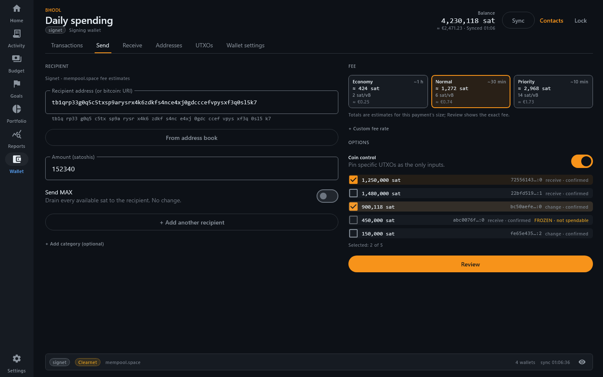

# BHODL

> A self-custodial Bitcoin wallet with a net-worth and spending tracker built in, that counts in sats.

BHODL is a desktop Bitcoin wallet (Rust core + Kotlin/Compose) with a personal-finance tracker
in the same app: net worth, budgets, bills, investments and goals, all measured in bitcoin
first. Fiat only shows up where it is operational (rent, bills, tax cost basis). No account,
no cloud, no telemetry: everything lives in an encrypted database on your machine.

## Status: alpha, test networks only

**Do not use BHODL with real funds.** Signing wallets can only be created on **Signet,
Testnet4 or Regtest**; mainnet signing is deliberately not available yet. The code has not
been audited.

| Area | State |
| --- | --- |
| Desktop app (Windows, Linux, macOS via the JVM) | Works; this is where all features live |
| On-chain wallet (single-sig taproot, BIP-86) | Works on signet / testnet4 / regtest |
| Net-worth & spending tracker | Works (watch-only mainnet xpubs can be tracked, with a privacy warning) |
| Android | The APK builds and packages the Rust core, but the app is a placeholder screen |
| iOS | Scaffold only, never built |
| Lightning, Liquid, Cashu / Fedimint, Ark | Planned, not started (see [`PLAN.md`](PLAN.md)) |
| Silent Payments (BIP-352), hardware wallets, multisig | Planned, not started |

## Features

**Wallet**

- BIP-39 seed, BIP-86 taproot single-sig, PSBT build / sign / broadcast via Esplora.
- Sparrow-style workspace: Transactions · Send · Receive · Addresses · UTXOs · Wallet settings.
- Send: fee presets with estimated total, ETA and fiat equivalent; custom sat/vB; batch
  recipients; Send MAX; coin control with freeze / unfreeze; input→output review diagram;
  high-fee guard.
- PayJoin (BIP-78) sender, with every output shown for review before signing.
- Fee bumping: RBF on outgoing, CPFP on incoming and on your own change.
- BIP-21 parsing and payment requests, address book, BIP-329 labels import / export.
- Optional Tor (SOCKS5) for all Esplora traffic; custom Esplora endpoint.
- Encryption at rest: SQLCipher, key derived with Argon2id from your PIN; age-encrypted
  backup export and restore.

**Tracker**

- Net worth in sats/BTC across signing wallets, watch-only xpubs, investments, manual assets
  (cash, real estate, vehicles…) and liabilities, with history.
- **Bitcoin Lens**: bitcoin is the unit of account. The BTC chart is not smoothed: if your
  fiat savings lose value against bitcoin, you see it.
- Investments with tax lots and FIFO / HIFO / Specific-ID cost basis, a sell flow that
  compares the methods, realized and unrealized P&L.
- Budgets, bills, recurring-payment detection, auto-categorization rules, savings and
  sinking-fund goals, cash-flow forecast, reports (Sankey, breakdowns) and CSV export.
- Wallet labels and categories flow into the tracker: label a payment once on Receive or
  Send and it is already categorized.

**Everywhere**

- Privacy mode (Ctrl+Shift+H) hides every amount, including chart axes and tooltips.
- Security Hub: backup verification, PIN, auto-lock, Tor and export status on one screen.
- Light, dark (follows the system) and an opt-in neon theme; sats, BTC or automatic units,
  optional BIP-177 `₿` notation; English and Italian; dense tables with a 24 px option;
  keyboard navigation and a table view for every chart.

## Screenshots

Rendered from the app with demo data on signet.

| | |
| --- | --- |
|  |  |
| Wallet: transactions with confirmation counts (light) | Wallet: send with fee presets and coin control |
|  |  |
| Tracker home: net worth in sats | Portfolio: balance sheet and investments with cost in BTC |
|  | |
| Budget: sats budgets with price vs spending split | |

## Building

Requirements: **Rust 1.88** (pinned in `rust-toolchain.toml`), **JDK 21**, Git. Docker is
only needed for the integration tests. Gradle comes from the wrapper.

```sh
./gradlew :apps:desktop:run          # build the Rust core and launch the desktop app (signet)
```

The first build compiles OpenSSL and SQLCipher from source and takes around 10 minutes;
later builds are incremental.

### Windows notes

- OpenSSL's build needs a full Perl. Git Bash's Perl lacks required modules, so install
  [Strawberry Perl](https://strawberryperl.com/) (`winget install StrawberryPerl.StrawberryPerl`)
  and put it first on `PATH` for the build session:
  ```sh
  export PATH="/c/Strawberry/perl/bin:/c/Strawberry/c/bin:$PATH"
  ```
- The vendored OpenSSL build creates deeply nested paths. If it fails with path-length
  errors (for example in a deep checkout or a git worktree), point Cargo at a short target
  directory, e.g. `export CARGO_TARGET_DIR=/c/t`.
- Smart App Control blocks the build. It refuses to run the build scripts Cargo compiles
  on your machine (`os error 4551`, events 3033/3077 in the CodeIntegrity log), and those
  cannot be signed in advance. The Gradle build checks for it and stops with a message.
  Either turn it off in Windows Security > App & browser control (on some Windows 11
  versions it cannot be turned back on without a reset) or build inside WSL2.

### Tests and checks

```sh
cargo test --workspace
cargo clippy --workspace --all-targets -- -D warnings
cargo fmt --all --check
cargo deny check                         # advisories, licenses, sources

./gradlew :shared:jvmTest                # FFI smoke tests
./gradlew :apps:desktop:jvmTest          # desktop unit + Compose UI tests
./gradlew :apps:desktop:integrationTest  # bitcoind regtest + electrs (Docker)
```

Live Tor tests (`scripts/tor-tests.sh`), coverage, the Android build and the details behind
each step are in the [developer handbook](docs/handbook.md).

### Android APK

The Rust core cross-compiles for Android and is packaged into the APK, but the Android UI
is not built yet. Build on **Linux, macOS or WSL2** (OpenSSL needs `make` and `perl`):

```sh
rustup target add aarch64-linux-android armv7-linux-androideabi i686-linux-android x86_64-linux-android
export ANDROID_HOME=$HOME/android-sdk                     # platforms;android-35, build-tools;35.0.0
export ANDROID_NDK_HOME=$ANDROID_HOME/ndk/28.0.12433566   # NDK r28
./gradlew :apps:android:assembleDebug
```

Gradle dependency verification is on (`gradle/verification-metadata.xml`). On a platform
not yet covered, run `./gradlew --write-verification-metadata sha256 <tasks>` first.

### Upgrading

Builds from the 2026-10 security audit onward use a newer key-derivation and registry
format; older builds cannot open that data. Keep your seed or backup and see
[handbook §6.1](docs/handbook.md#61-upgrading--downgrading).

## Repository layout

```
.
├── crates/
│   ├── bhodl-core/             # Amount, Network, Argon2id KDF
│   ├── bhodl-wallet-onchain/   # BDK wallet, SQLCipher persistence, registry, PayJoin, Tor
│   └── bhodl-uniffi/           # FFI surface for Kotlin (UniFFI)
├── shared/                     # Kotlin Multiplatform module: theme, generated bindings
├── apps/
│   ├── desktop/                # Compose Desktop app: wallet + tracker
│   ├── android/                # Android host app (placeholder UI, packages the Rust core)
│   └── ios/                    # iOS scaffold (not built)
├── design/                     # Design tokens, theme reference, contrast report
├── docs/                       # Handbook, test book, design reviews, research notes
├── scripts/                    # Helper scripts (Tor tests)
├── PLAN.md                     # Product plan and roadmap (Italian)
└── TECH_STACK.md               # Libraries and standards
```

## Contributing: help wanted on design & UX

The backend is in good shape; the product needs design help more than anything. If you
design interfaces, you do not need to build the project to contribute:

- Pick a task from [`docs/design-help-wanted.md`](docs/design-help-wanted.md)
  (Lightning flows, mobile layouts, onboarding, data visualization, branding…).
- Open a [design feedback issue](https://github.com/mariepellegrino89/bhodl/issues/new?template=design_feedback.yml) on any
  screen in the screenshots above.
- Read the design direction in [`docs/ux-review-2026-10.md`](docs/ux-review-2026-10.md)
  and the tokens in [`design/`](design/).

Code contributions are welcome too. Start with [`CONTRIBUTING.md`](CONTRIBUTING.md) and the
[developer handbook](docs/handbook.md). Security issues: see [`SECURITY.md`](SECURITY.md),
never a public issue.

Some planning and design documents (`PLAN.md`, `design/README.md`, the UX review, research
notes) are in Italian; translations are welcome.

## License

Dual-licensed under either of

- Apache License, Version 2.0 ([`LICENSE-APACHE`](LICENSE-APACHE))
- MIT License ([`LICENSE-MIT`](LICENSE-MIT))

at your option. Unless you explicitly state otherwise, any contribution intentionally
submitted for inclusion in BHODL by you, as defined in the Apache-2.0 license, shall be
dual licensed as above, without any additional terms or conditions.
