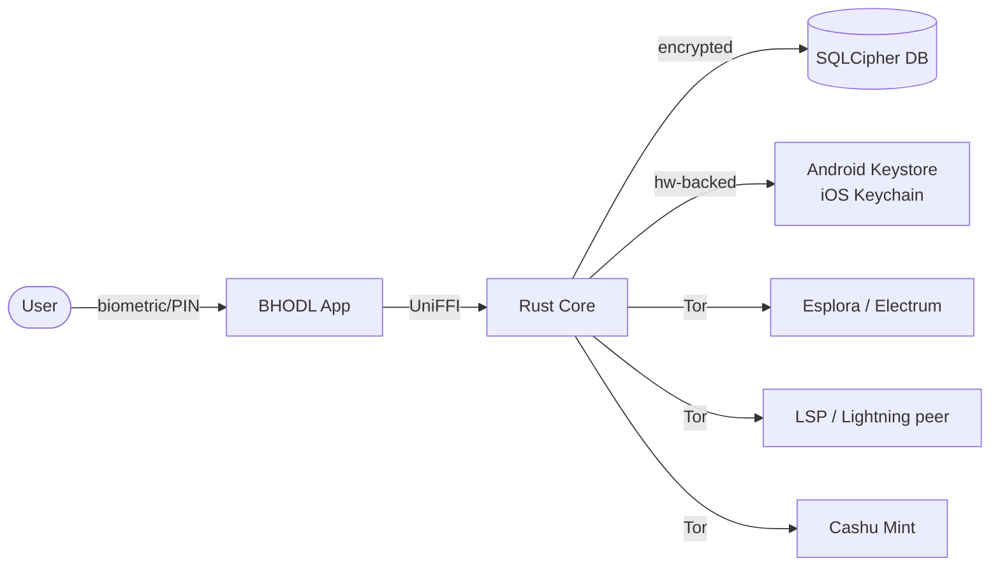

# Documentation patterns per BHODL — ricerca su wallet bitcoin self-custodial open source

> Ricerca condotta a maggio 2026 confrontando 8 progetti di riferimento (BDK, LDK,
> LWK, Liana, Cake Wallet, Bull Bitcoin Mobile, CDK, Fedimint, BTCPay Server,
> Wasabi Wallet) per stilare una raccomandazione operativa su **cosa** documentare
> in BHODL, **come** scriverlo, **quando** crearlo e **chi** ne è owner.
>
> Repo BHODL: `mariepellegrino89/bhodl` (privato fino a fine Phase 1).
> Stack: Rust core (BDK + LDK + LWK + CDK + Boltz) + Kotlin Multiplatform +
> Compose Multiplatform via UniFFI. Dual MIT/Apache-2.0.

---

## 1. TL;DR — la lista di documenti raccomandata per BHODL

Tre tier di priorità, allineati al timeline `PLAN.md`:

### Must-have (Phase 0, già urgenti — entro fine Phase 0)

| # | File                              | Scopo                                               |
|---|-----------------------------------|-----------------------------------------------------|
| 1 | `CONTRIBUTING.md`                 | Onboarding contributor, code style, PR workflow     |
| 2 | `SECURITY.md`                     | Responsible disclosure, PGP/age key, scope          |
| 3 | `CODE_OF_CONDUCT.md`              | Contributor Covenant 2.1                            |
| 4 | `BUILDING.md`                     | Setup toolchain Rust + KMP + Android/iOS            |
| 5 | `docs/adr/0000-template.md`       | Template MADR + 1-2 ADR già scritti                 |
| 6 | `.github/PULL_REQUEST_TEMPLATE.md`| Checklist PR (tests, docs, BIP refs)                |
| 7 | `.github/ISSUE_TEMPLATE/*`        | bug.yml, feature.yml, security.yml (silent)         |
| 8 | `.github/CODEOWNERS`              | Routing review per crate                            |

### Should-have (Phase 1, prima del primo public release)

| #  | File                              | Scopo                                              |
|----|-----------------------------------|----------------------------------------------------|
| 9  | `ARCHITECTURE.md`                 | High-level architecture, layer boundaries          |
| 10 | `THREAT_MODEL.md`                 | STRIDE per layer + assumptions + non-goals         |
| 11 | `CHANGELOG.md`                    | Keep-a-Changelog format, alimentato pre-rilascio   |
| 12 | `docs/book/` (mdBook)             | User guide + dev guide unificati                   |
| 13 | `BIP_COMPLIANCE.md`               | Matrice BIP supportati / pianificati / fuori scope |
| 14 | `REPRODUCIBLE_BUILDS.md`          | Procedura per APK/IPA/desktop deterministici       |
| 15 | `RELEASE_CHECKLIST.md`            | Step di rilascio firmato (sigstore/PGP)            |
| 16 | `PRIVACY.md`                      | Cosa NON viene mai inviato + opt-in Tor/network    |
| 17 | `.github/FUNDING.yml`             | Sponsor links (GitHub Sponsors, Geyser, BTCPay)    |

### Nice-to-have (Phase 2 / post-launch)

| #  | File                              | Scopo                                              |
|----|-----------------------------------|----------------------------------------------------|
| 18 | `audits/` folder                  | Report audit esterni firmati (PGP)                 |
| 19 | `ROADMAP.md`                      | Roadmap pubblica (link a GitHub Projects)          |
| 20 | `GOVERNANCE.md`                   | Ruoli maintainer, decisioni, BDFL/consensus        |
| 21 | `docs/research/`                  | Note di ricerca su soft-fork, attacchi, design     |
| 22 | `TRANSLATIONS.md`                 | Workflow Weblate/Crowdin per UI strings + docs     |
| 23 | `docs/api/` (auto-gen)            | rustdoc + Dokka pubblicati su GitHub Pages         |
| 24 | `MAINTAINERS.md`                  | Lista maintainer attivi + chiavi PGP               |

**Stima ore must-have**: ~30-45 ore (dettaglio in §6).

---

## 2. Analisi per progetto

### 2.1 — Bitcoin Dev Kit (`bitcoindevkit/bdk`)

- **URL**: https://github.com/bitcoindevkit/bdk
- **Riassunto**: libreria Rust per descriptor wallet, monorepo workspace con 6 crate.
- **File top-level rilevanti**:
  - `README.md`, `CONTRIBUTING.md`, `SECURITY.md`
  - `LICENSE-APACHE` + `LICENSE-MIT` + `LICENSE` (combined)
  - `DEVELOPMENT_CYCLE.md` — descrive il release cycle (utile come riferimento)
  - `rust-version` — pinning MSRV separato da `Cargo.toml`
  - `clippy.toml` + `rustfmt.toml` + `justfile`
  - **No** `CODE_OF_CONDUCT.md`, `ARCHITECTURE.md`, `CHANGELOG.md`, `ROADMAP.md`,
    `THREAT_MODEL.md`, `audits/`
- **`docs/`**: contiene solo `docs/adr/` con tre ADR e un `template.md`.
- **Toolchain docs**: rustdoc autogenerata + ADR plain markdown. Nessun mdBook.
- **ADR format**: **MADR** (Markdown Architecture Decision Records), naming
  `NNNN_descrizione.md`. Sezioni: Status, Authors, Date, Targeted modules,
  Context and Problem Statement, Decision Drivers, Considered Options (con
  pros/cons), Decision Outcome, Positive/Negative Consequences, Links.
- **CONTRIBUTING.md notabile**: usa `just` per tutti i comandi, MSRV 1.85,
  Conventional Commits, **GPG sign obbligatorio**, no DCO.
- **SECURITY.md**: minimale. Solo email + PGP fingerprint. No supported-versions
  table, no SLA, no bounty.
- **Cosa BHODL può imitare**:
  - ADR format MADR + cartella `docs/adr/` con `template.md`.
  - `justfile` per centralizzare comandi dev.
  - Dual licensing files identici (BHODL li ha già).
  - `DEVELOPMENT_CYCLE.md` come ispirazione per `RELEASE_CHECKLIST.md`.
- **Cosa NON imitare**: SECURITY.md troppo minimale, mancanza di
  CODE_OF_CONDUCT, mancanza di CHANGELOG strutturato.

### 2.2 — Lightning Dev Kit (`lightningdevkit/rust-lightning`)

- **URL**: https://github.com/lightningdevkit/rust-lightning
- **Riassunto**: libreria modulare Lightning in Rust (oltre 12 crate `lightning-*`).
- **File top-level rilevanti**:
  - `README.md`, `CONTRIBUTING.md`, `SECURITY.md`, `CHANGELOG.md`
  - **`ARCH.md`** — documento architetturale (raro, modello da imitare)
  - **`GLOSSARY.md`** — terminologia Lightning (utilissimo per onboarding)
  - `LICENSE-APACHE`, `LICENSE-MIT`, `LICENSE.md` (overview)
  - `pending_changelog/` — cartella per note di rilascio in corso (workflow
    pre-bump version)
- **`docs/`**: assente come root folder; documentazione distribuita per crate.
- **Toolchain docs**: rustdoc + markdown plain.
- **SECURITY.md notabile**: 5 GPG keys di altrettanti maintainer (Matt Corallo,
  Jeffrey Czyz, Wilmer Paulino, Elias Rohrer, Valentine Wallace), dichiarazione
  esplicita che include "denial-of-service vulnerabilities such as spurious panics".
- **Cosa BHODL può imitare**:
  - **`ARCH.md`** singolo file di livello root come overview rapida (vedi §4).
  - **`GLOSSARY.md`** — vista la complessità multi-layer di BHODL (Lightning +
    Liquid + Cashu + Ark) un glossario è quasi obbligatorio.
  - Multi-PGP key in `SECURITY.md` (ora c'è solo il maintainer, ma quando arrivano
    co-maintainer va estesa).
  - `pending_changelog/` come workflow per evitare merge conflict sul CHANGELOG.

### 2.3 — Liquid Wallet Kit (`Blockstream/lwk`)

- **URL**: https://github.com/Blockstream/lwk
- **Riassunto**: libreria Liquid (Elements) in Rust con bindings WASM e mobile.
- **File top-level rilevanti**:
  - `README.md`, `LICENSE` (MIT), `flake.nix` + `rust-toolchain.toml`
  - `AGENTS.md` + `CLAUDE.md` (LLM-aware repo)
  - `justfile`
  - **No** `CONTRIBUTING.md`, `SECURITY.md`, `CODE_OF_CONDUCT.md` a livello root
    (assenza notabile per un progetto Blockstream).
- **`docs/`**: **mdBook** completo.
  - `book.toml` (config)
  - `README.md` + `GUIDE.md` (style guide per nuovi contributi)
  - `mermaid.min.js` + `mermaid-init.js` per diagrammi
  - `styles.css`, `tabs.js` (custom theme)
  - `snippets/` con processor tool per estrarre codice eseguibile dai chapter
  - `src/` con i capitoli del libro
  - Pubblicato su `blockstream.github.io/lwk/book/`
- **Toolchain docs**: **mdBook + mermaid + snippet tested**.
- **Cosa BHODL può imitare**:
  - **mdBook con mermaid** è il pattern migliore per BHODL: gestisce sia user
    docs sia dev docs, supporta diagrammi (necessari per architettura
    multi-layer), e i `snippets/` testati eliminano il rischio di esempi rotti.
  - GitHub Actions per pubblicare il book su Pages.
- **Cosa NON imitare**: il vuoto su CONTRIBUTING/SECURITY/CoC è un anti-pattern.

### 2.4 — Liana (`wizardsardine/liana`)

- **URL**: https://github.com/wizardsardine/liana
- **Riassunto**: wallet inheritance basato su miniscript, daemon + GUI iced.
- **File top-level rilevanti**:
  - `README.md`, `CONTRIBUTING.md`, `SECURITY.md`, `CHANGELOG.md`, `LICENCE`
    (BSD-3-Clause)
  - `flake.nix` + `rust-toolchain.toml`
  - **No** `ARCHITECTURE.md`, `THREAT_MODEL.md`, `BUILDING.md` a livello root
- **`doc/`** (singolare!): contiene `USAGE.md`, `TRY.md` — istruzioni utente
  finale. Plain markdown, no toolchain.
- **Toolchain docs**: rustdoc + markdown plain.
- **CONTRIBUTING.md notabile**:
  - MSRV 1.63 esplicitamente per **compatibilità con Guix, Debian packaging,
    e mrustc** — pattern molto bitcoin-core-style.
  - Commit message: subject + blank + paragraph esplicativo (cita
    https://cbea.ms/git-commit/), commit atomici.
  - **No GPG sign obbligatorio**, **no DCO**.
  - "Conceptual review prima di style review" — pattern BIPs/Bitcoin Core.
- **Cosa BHODL può imitare**:
  - MSRV pinning con motivazione esplicita (BHODL già usa Rust 1.85, dichiarare
    perché in `BUILDING.md`).
  - Filosofia "atomic commits + good message" da `cbea.ms/git-commit/`.
  - Nix flake per dev env riproducibile (BHODL può aggiungerlo in Phase 1).
- **Cosa NON imitare**: assenza di `THREAT_MODEL.md` esplicito è una mancanza
  in un wallet inheritance che vende sicurezza come feature core.

### 2.5 — Bull Bitcoin Mobile (`SatoshiPortal/bullbitcoin-mobile`)

- **URL**: https://github.com/SatoshiPortal/bullbitcoin-mobile
- **Riassunto**: wallet mobile Flutter con Payjoin v2 + Silent Payments + Liquid.
  È il progetto **più vicino a BHODL** per ambizione.
- **File top-level rilevanti**:
  - `README.md`, `ARCHITECTURE.md`, `CHANGELOG.md`, `LICENSE` (MIT)
  - `Dockerfile` + `Dockerfile.apk` (riproducibilità via container)
  - `makefile`, `pubspec.yaml`, `analysis_options.yaml`, `l10n.yaml`
  - **`reproducibility/`** — cartella dedicata
  - `.devcontainer/`, `.git_hooks/`
  - **No** `CONTRIBUTING.md`, `SECURITY.md`, `CODE_OF_CONDUCT.md` (anti-pattern)
- **`docs/`**: contiene solo `CNAME` per GitHub Pages — quasi vuoto.
- **`reproducibility/`**: 4 file:
  - `Dockerfile` (immagine con apktool + bundletool + Java)
  - `README.md`
  - `verify_build.sh` (orchestration)
  - `test.sh`
  - **Strategia**: `SOURCE_DATE_EPOCH` da `git log` + `CARGO_ENCODED_RUSTFLAGS`
    per rewrite path Rust assoluti. Compara APK published vs APK built escludendo
    metadata firma.
- **Toolchain docs**: nessuna (markdown plain).
- **Cosa BHODL può imitare**:
  - **Cartella `reproducibility/` è ORO** per BHODL: stessa identica strategia
    funziona per Android (APK) ed estendibile a iOS (IPA via fastlane match) e
    desktop (CMP/JVM). Vedi §4 per dettagli.
  - `ARCHITECTURE.md` come singolo file root (non monorepo docs/).
  - `.devcontainer/` per onboarding contributor zero-friction.
- **Cosa NON imitare**: assenza di `CONTRIBUTING.md`/`SECURITY.md` rende il
  progetto contributor-hostile nonostante sia prod-quality.

### 2.6 — Cake Wallet (`cake-tech/cake_wallet`)

- **URL**: https://github.com/cake-tech/cake_wallet
- **Riassunto**: multi-asset Flutter wallet (BTC, XMR, LTC, ETH, ecc.).
- **File top-level rilevanti**:
  - `README.md`, **`PRIVACY.md`**, `LICENSE.md` (MIT)
  - `howto-build-android.md` (file ad-hoc, non `BUILDING.md` standard)
  - `/docs/` esiste ma minimale
  - `/res/values/strings_XX.arb` — i18n a livello root
  - **No** `CONTRIBUTING.md`, `SECURITY.md`, `ARCHITECTURE.md`, `THREAT_MODEL.md`
- **Toolchain docs**: esterno — `https://docs.cakewallet.com` (separato dal repo).
- **Cosa BHODL può imitare**:
  - **`PRIVACY.md`** dedicato e di alto profilo: pattern molto buono per un
    wallet che fa privacy-by-default sua bandiera.
  - i18n con file `.arb` per platform-native (per CMP useremo `compose-multiplatform-resources`).
- **Cosa NON imitare**:
  - Documentazione esterna scollegata dal repo: rende le PR molto difficili da
    sincronizzare con i docs.
  - `howto-build-android.md` ad-hoc invece di `BUILDING.md` standard.

### 2.7 — CDK (`cashubtc/cdk`)

- **URL**: https://github.com/cashubtc/cdk
- **Riassunto**: Cashu Development Kit in Rust (28 NUTs implementati).
- **File top-level rilevanti**:
  - `README.md`, `CHANGELOG.md`, `SECURITY.md`, `LICENSE` (MIT)
  - **`DEVELOPMENT.md`** — invece di `CONTRIBUTING.md`
  - **`CODE_STYLE.md`** — separato (utile pattern)
  - **`REGTEST_GUIDE.md`** — guide testing dedicata
  - `AGENTS.md` (LLM-aware)
- **`docs/migrations/`** — solo migration docs (per schema DB).
- **Toolchain docs**: rustdoc + markdown plain. No mdBook.
- **Cosa BHODL può imitare**:
  - Splittare `CODE_STYLE.md` da `CONTRIBUTING.md` (pattern utile se le regole
    di stile diventano lunghe — per BHODL le regole sono diverse tra Rust e
    Kotlin).
  - **`REGTEST_GUIDE.md`** dedicato: BHODL avrà bisogno di un equivalente
    che copra Polar + Nigiri + signet (Mutinynet).
- **Cosa NON imitare**: nomi non-standard (`DEVELOPMENT.md` vs
  `CONTRIBUTING.md`) confondono GitHub che cerca pattern conosciuti per i
  community health checks.

### 2.8 — Fedimint (`fedimint/fedimint`)

- **URL**: https://github.com/fedimint/fedimint
- **Riassunto**: federazione e-cash chaumiana, modulare in Rust.
- **File top-level rilevanti**:
  - `README.md`, `CONTRIBUTING.md`, `CHANGELOG.md`
  - **`HACKING.md`** — guida dev approfondita
  - `AGENTS.md`, `CLAUDE.md`
  - `nix/`, `docker/`
  - **No** `SECURITY.md`, `CODE_OF_CONDUCT.md`, `ARCHITECTURE.md`,
    `THREAT_MODEL.md` a livello root
- **`docs/`**: contiene docs strutturate, pubblicate su `docs.fedimint.org`.
- **Toolchain docs**: probabilmente mdBook (sito esterno fedimint.org).
- **Cosa BHODL può imitare**:
  - **`HACKING.md`** come complemento a `CONTRIBUTING.md`: il primo è "come
    contribuire socialmente", il secondo è "come compilare/debuggare/profilare
    in profondità".
  - Multi-canale comunicazione (Discord + GitHub discussions + dev calls +
    PR review sessions) elencati esplicitamente nel README.

### 2.9 — Bonus: BTCPay Server, Wasabi Wallet (riferimenti collaterali)

- **BTCPay Server** (`btcpayserver/btcpayserver`): ha `RELEASE-CHECKLIST.md` +
  `RELEASE-CYCLES.md` separati, pattern utile per BHODL `RELEASE_CHECKLIST.md`.
  Docs in `docs/` plain markdown (`db-migration.md`, `greenfield-authorization.md`,
  `greenfield-development.md`, ecc.) — no mdBook.
- **Wasabi Wallet** (`WalletWasabi/WalletWasabi`): `PGP.txt` come file dedicato a
  livello root per la chiave del progetto, `WalletWasabi.Documentation/` come
  cartella docs separata. Nessun `ARCHITECTURE.md`/`THREAT_MODEL.md` esposto.

### 2.10 — Progetti citati nel brief ma non analizzati

- **block/bitkey** o **cash-app/bitkey**: non confermato pubblicamente
  accessibile su GitHub al momento della ricerca (Block ha rilasciato firmware
  ma il repo non è risultato standard `block/bitkey` raggiungibile da WebFetch).
  Fonte raccomandata: repo `proto-at-block/bitkey-fromagerie` se accessibile.
- **breez/breez-sdk-liquid**: docs esterne (`sdk-doc-liquid.breez.technology`),
  in repo solo `README.md` + `CONTRIBUTING.md` + `DEVELOPMENT.md`. API docs su
  GitHub Pages (`breez.github.io/breez-sdk-liquid/`).
- **cryptopower**, **specter-desktop**, **sparrow**: non investigati per limiti
  di tempo; pattern generali coperti dai 8 progetti sopra.

---

## 3. Tabella riassuntiva — matrice doc × progetto

Legenda: ✓ presente · ✗ assente · ~ parziale o ad-hoc · — non applicabile

| Documento                  | BDK | LDK | LWK | Liana | BullBTC | Cake | CDK | Fedimint | BTCPay | Wasabi |
|----------------------------|-----|-----|-----|-------|---------|------|-----|----------|--------|--------|
| README.md                  | ✓   | ✓   | ✓   | ✓     | ✓       | ✓    | ✓   | ✓        | ✓      | ✓      |
| CONTRIBUTING.md            | ✓   | ✓   | ✗   | ✓     | ✗       | ✗    | ~   | ✓        | ✗      | ✓      |
| CODE_OF_CONDUCT.md         | ✗   | ✗   | ✗   | ✗     | ✗       | ✗    | ✗   | ✗        | ✗      | ✗      |
| SECURITY.md                | ✓   | ✓   | ✗   | ✓     | ✗       | ✗    | ✓   | ✗        | ✓      | ✓      |
| ARCHITECTURE.md / ARCH.md  | ✗   | ✓   | ✗   | ✗     | ✓       | ✗    | ✗   | ✗        | ✗      | ✗      |
| GLOSSARY.md                | ✗   | ✓   | ✗   | ✗     | ✗       | ✗    | ✗   | ✗        | ✗      | ✗      |
| CHANGELOG.md               | ✗   | ✓   | ✗   | ✓     | ✓       | ✗    | ✓   | ✓        | ✓      | ✗      |
| ROADMAP.md                 | ✗   | ✗   | ✗   | ✗     | ✗       | ✗    | ✗   | ✗        | ✗      | ✗      |
| THREAT_MODEL.md            | ✗   | ✗   | ✗   | ✗     | ✗       | ✗    | ✗   | ✗        | ✗      | ✗      |
| PRIVACY.md                 | ✗   | ✗   | ✗   | ✗     | ✗       | ✓    | ✗   | ✗        | ✗      | ✗      |
| BUILDING.md                | ~   | ✗   | ✗   | ✗     | ~       | ~    | ~   | ~        | ~      | ✗      |
| RELEASE_CHECKLIST.md       | ✓   | ✗   | ✗   | ✗     | ✗       | ✗    | ✗   | ✗        | ✓      | ✗      |
| docs/adr/                  | ✓   | ✗   | ✗   | ✗     | ✗       | ✗    | ✗   | ✗        | ✗      | ✗      |
| mdBook docs/               | ✗   | ✗   | ✓   | ✗     | ✗       | —    | ✗   | ~        | ✗      | ~      |
| Reproducible builds folder | ✗   | ✗   | ✗   | ~     | ✓       | ✗    | ✗   | ✗        | ✗      | ✗      |
| audits/                    | ✗   | ✗   | ✗   | ✗     | ✗       | ✗    | ✗   | ✗        | ✗      | ✗      |
| BIP compliance matrix      | ✗   | ✗   | ✗   | ✗     | ✗       | ✗    | ✗   | —        | ✗      | ✗      |
| FUNDING.yml                | ?   | ?   | ?   | ?     | ?       | ?    | ?   | ?        | ?      | ?      |
| CODEOWNERS                 | ✓   | ?   | ?   | ?     | ?       | ?    | ?   | ?        | ?      | ?      |
| ISSUE_TEMPLATE/            | ✓   | ?   | ?   | ?     | ?       | ?    | ?   | ?        | ?      | ?      |

**Osservazioni chiave**:
- **Nessun progetto** ha un `THREAT_MODEL.md` esplicito a livello root: BHODL
  può differenziarsi pubblicandone uno (forte segnale di serietà security).
- **Nessun progetto** ha `ROADMAP.md` (tutti su GitHub Projects/Milestones).
- **Nessun progetto** pubblica `audits/` folder (probabilmente perché poche
  hanno avuto audit; quando li hanno li pubblicano in blog/PDF esterni).
- **CODE_OF_CONDUCT.md è raro** in ecosistema Bitcoin (cultura "code-first"),
  ma BHODL essendo open source e cercando contributor mainstream dovrebbe
  averlo (Contributor Covenant 2.1 standard).
- **Reproducible builds** è raro ma è un pattern critico per wallet mobili:
  Bull Bitcoin è il riferimento.
- **mdBook** è la toolchain dominante in ecosistema Rust+Bitcoin (LWK, ldk-book
  esterno, rust-bitcoin book).

---

## 4. Raccomandazione finale per BHODL

### 4.1 — Distinzione netta tra tre categorie di docs

Per orientarsi, BHODL avrà tre categorie distinte di documentazione, ciascuna
con toolchain diversa e owner diverso:

| Categoria       | Cosa                              | Toolchain               | Audience          | Owner                        |
|-----------------|-----------------------------------|-------------------------|-------------------|------------------------------|
| **Code docs**   | rustdoc, KDoc/Dokka, doc-comments | rustdoc, Dokka          | Dev (API users)   | Auto-gen da CI               |
| **Product docs**| Guide utente, dev guide, tutorial | mdBook + mermaid        | Dev + utente      | Maintainer (scrittura umana) |
| **Process docs**| CONTRIBUTING, SECURITY, ADR, ROADMAP | Plain markdown       | Contributor       | Maintainer + community       |

### 4.2 — Lista completa documenti con specifiche

#### CATEGORIA 1: Process docs (plain markdown a livello root)

| File                              | Audience    | Quando        | Owner       | Toolchain | Reference template                                        |
|-----------------------------------|-------------|---------------|-------------|-----------|-----------------------------------------------------------|
| `README.md`                       | Tutti       | ✅ esiste     | Maintainer  | Markdown  | (BHODL ce l'ha già; vedi §4.4 per estensioni)             |
| `CONTRIBUTING.md`                 | Contributor | Phase 0       | Maintainer  | Markdown  | https://raw.githubusercontent.com/bitcoindevkit/bdk/master/CONTRIBUTING.md |
| `CODE_OF_CONDUCT.md`              | Community   | Phase 0       | Maintainer  | Markdown  | https://www.contributor-covenant.org/version/2/1/code_of_conduct/ |
| `SECURITY.md`                     | Security    | Phase 0       | Maintainer  | Markdown  | https://raw.githubusercontent.com/lightningdevkit/rust-lightning/main/SECURITY.md |
| `BUILDING.md`                     | Contributor | Phase 0       | Maintainer  | Markdown  | (custom — vedi §4.5)                                      |
| `ARCHITECTURE.md` (o `ARCH.md`)   | Dev         | Phase 1       | Architect   | Markdown  | https://github.com/lightningdevkit/rust-lightning/blob/main/ARCH.md |
| `GLOSSARY.md`                     | Tutti       | Phase 1       | Maintainer  | Markdown  | https://github.com/lightningdevkit/rust-lightning/blob/main/GLOSSARY.md |
| `THREAT_MODEL.md`                 | Security    | Phase 1       | Security    | Markdown  | (custom — vedi §6 di questo doc)                          |
| `PRIVACY.md`                      | Utente      | Phase 1       | Maintainer  | Markdown  | https://github.com/cake-tech/cake_wallet/blob/main/PRIVACY.md |
| `CHANGELOG.md`                    | Tutti       | Phase 1       | Auto + man  | Markdown  | https://keepachangelog.com/en/1.1.0/                      |
| `BIP_COMPLIANCE.md`               | Dev         | Phase 1       | Maintainer  | Markdown  | (custom — vedi §7 di questo doc)                          |
| `RELEASE_CHECKLIST.md`            | Maintainer  | Phase 1       | Maintainer  | Markdown  | https://github.com/btcpayserver/btcpayserver/blob/master/RELEASE-CHECKLIST.md |
| `REPRODUCIBLE_BUILDS.md` (+ folder)| Auditor    | Phase 1       | DevOps      | Markdown + Docker | https://github.com/SatoshiPortal/bullbitcoin-mobile/tree/main/reproducibility |
| `MAINTAINERS.md`                  | Tutti       | Phase 2       | Maintainer  | Markdown  | (custom — lista nome, ruolo, PGP key, area)               |
| `GOVERNANCE.md`                   | Community   | Phase 2       | Maintainer  | Markdown  | (BDFL-style iniziale)                                     |
| `ROADMAP.md`                      | Tutti       | Phase 2       | Maintainer  | Markdown  | (link a GitHub Projects)                                  |
| `TRANSLATIONS.md`                 | Translator  | Phase 2       | i18n lead   | Markdown  | (Weblate o Crowdin workflow)                              |

#### CATEGORIA 2: Process docs in `.github/`

| File                              | Audience    | Quando        | Owner       | Toolchain | Note                                                       |
|-----------------------------------|-------------|---------------|-------------|-----------|------------------------------------------------------------|
| `.github/PULL_REQUEST_TEMPLATE.md`| Contributor | Phase 0       | Maintainer  | Markdown  | Checklist: tests, docs, BIP refs, CHANGELOG entry          |
| `.github/ISSUE_TEMPLATE/bug.yml`  | Utente      | Phase 0       | Maintainer  | YAML form | GitHub issue forms (più strutturato di markdown)           |
| `.github/ISSUE_TEMPLATE/feature.yml`| Utente    | Phase 0       | Maintainer  | YAML form |                                                            |
| `.github/ISSUE_TEMPLATE/config.yml`| —          | Phase 0       | Maintainer  | YAML      | `blank_issues_enabled: false` + redirect security a SECURITY.md |
| `.github/CODEOWNERS`              | —           | Phase 0       | Maintainer  | Plain     | `crates/bhodl-wallet-onchain/ @mariepellegrino89` ecc.     |
| `.github/FUNDING.yml`             | Tutti       | Phase 1       | Maintainer  | YAML      | github sponsors + custom (Geyser, BTCPay donation page)    |
| `.github/dependabot.yml`          | —           | Phase 0       | DevOps      | YAML      | Cargo + Gradle + GitHub Actions                            |

#### CATEGORIA 3: Product docs (`docs/book/` con mdBook)

Struttura proposta:

```
docs/
├── adr/
│   ├── README.md                      # spiegazione formato ADR
│   ├── template.md                    # MADR template
│   ├── 0001-rust-core-uniffi-kmp.md   # decisione stack (ADR storico)
│   ├── 0002-sqlcipher-persistence.md
│   └── 0003-bdk-wallet-vs-custom.md
├── book/
│   ├── book.toml                      # config mdBook
│   ├── theme/
│   │   ├── mermaid.min.js
│   │   └── mermaid-init.js
│   └── src/
│       ├── SUMMARY.md                 # TOC
│       ├── intro.md
│       ├── user/                      # USER GUIDE
│       │   ├── installation.md
│       │   ├── first-wallet.md
│       │   ├── backup-restore.md
│       │   ├── send-receive.md
│       │   ├── lightning.md
│       │   ├── liquid.md
│       │   ├── cashu-fedimint.md
│       │   ├── ark.md
│       │   ├── net-worth-tracking.md
│       │   ├── spending-categories.md
│       │   └── privacy-tor.md
│       ├── developer/                 # DEV GUIDE
│       │   ├── architecture.md       # link da/a ARCHITECTURE.md root
│       │   ├── crates-overview.md
│       │   ├── uniffi-bindings.md
│       │   ├── compose-multiplatform.md
│       │   ├── testing.md            # regtest + signet + Mutinynet
│       │   ├── debugging.md
│       │   └── adding-a-layer.md
│       ├── security/
│       │   ├── threat-model.md       # link da/a THREAT_MODEL.md root
│       │   ├── bip-compliance.md     # link da/a BIP_COMPLIANCE.md root
│       │   └── audits.md             # link a audits/
│       └── reference/
│           ├── glossary.md
│           ├── bip-index.md
│           └── faq.md
├── api/                               # auto-gen, gitignored
│   ├── rust/                          # rustdoc HTML output
│   └── kotlin/                        # Dokka HTML output
└── research/                          # questo file vive qui
    └── documentation-patterns.md
```

#### CATEGORIA 4: Code docs (auto-generata da CI)

| Toolchain          | Cosa documenta              | Quando rigenerata                       | Pubblicato dove              |
|--------------------|-----------------------------|-----------------------------------------|------------------------------|
| `cargo doc`        | tutti i crate Rust public   | ogni push su `main`                     | GitHub Pages `/docs/api/rust/`|
| `dokka`            | shared module Kotlin public | ogni push su `main`                     | GitHub Pages `/docs/api/kotlin/`|
| `mdbook build`     | docs/book                   | ogni push su `main` + preview su PR     | GitHub Pages `/book/`        |

### 4.3 — CI integration: cosa va check-ato automaticamente

Aggiungere workflow dedicato `.github/workflows/docs.yml`:

| Check                                     | Tool                             | Bloccante? |
|-------------------------------------------|----------------------------------|------------|
| Markdown linting                          | `markdownlint-cli2`              | sì         |
| Link broken (interni + esterni)           | `lychee` (Rust, veloce)          | sì interni / warn esterni |
| Spelling (EN solo)                        | `cspell` o `typos`               | warn       |
| ADR template compliance                   | script bash custom               | sì         |
| `cargo doc` builds without warnings       | `RUSTDOCFLAGS="-D warnings"`     | sì         |
| Dokka builds without warnings             | gradle `dokkaHtml`               | sì         |
| `mdbook build` succeeds                   | `mdbook build docs/book`         | sì         |
| `mdbook test` (esegue snippet codice)     | `mdbook test docs/book`          | sì (Phase 1) |
| CHANGELOG.md aggiornata su PR             | `release-please-action` o check  | warn       |
| BIP_COMPLIANCE.md aggiornata se nuovo BIP | label-based check                | warn       |

### 4.4 — Localizzazione docs: solo EN o anche IT?

Raccomandazione: **EN-only per docs tecnici** (CONTRIBUTING, SECURITY,
ARCHITECTURE, ADR, BIP_COMPLIANCE, THREAT_MODEL, ecc.). EN è la lingua di
riferimento per Bitcoin OSS contributor.

**IT (e altre lingue) per**:
- UI strings (gestite via `compose-multiplatform-resources`).
- User guide nel mdBook (`docs/book/src/user/it/...`) — solo da Phase 2 quando
  c'è una community che richiede la traduzione.
- README potrebbe avere un `README.it.md` come courtesy.

**Workflow traduzioni** (Phase 2):
- UI strings: Weblate self-hosted (open source, no vendor lock-in) o Crowdin
  free plan per OSS.
- Docs: traduzioni manuali via PR, con `docs/book/src/<lang>/SUMMARY.md`.

### 4.5 — Estensione consigliata del README.md attuale

Il `README.md` attuale di BHODL è ottimo come placeholder ma andrà esteso prima
del primo public release con:

1. Badge: build status, test coverage, license, MSRV, CI, GitHub Sponsors.
2. Screenshot/GIF della UI (quando disponibile).
3. Sezione "Features" sintetica (quale layer è supportato a che livello).
4. "Quick start" per utente finale (link al book per dettagli).
5. "For contributors" → link a CONTRIBUTING.md, BUILDING.md, ARCHITECTURE.md.
6. "Security" → link a SECURITY.md + THREAT_MODEL.md.
7. "Comparable projects" o "Acknowledgments" (citare BDK, LDK, LWK, ecc.).
8. Footer: Mastodon/Nostr, Discord/Matrix, donation address.

---

## 5. ADR format proposto per BHODL

BHODL adotta il **MADR (Markdown Architecture Decision Records) format**, lo
stesso di BDK. Naming `NNNN-kebab-case-title.md`.

### 5.1 — Template (`docs/adr/template.md`)

```markdown
# NNNN - Titolo della decisione

- **Status**: Proposed | Accepted | Deprecated | Superseded by [ADR-XXXX]
- **Date**: YYYY-MM-DD
- **Authors**: @github-handle, @altro-handle
- **Targeted modules**: `crates/bhodl-wallet-onchain`, `shared/`, ecc.
- **Associated tickets/PRs**: #123, #456

## Context and Problem Statement

Descrizione del problema in 2-5 paragrafi. Cosa stiamo cercando di risolvere?
Quali vincoli (tecnici, legali, business) entrano in gioco?

## Decision Drivers (optional)

- Driver 1: es. "compatibilità con HW wallet che supportano solo PSBT v0"
- Driver 2: es. "tempo di compilazione su CI < 10 minuti"
- Driver 3: es. "no dipendenze C non audited"

## Considered Options

### Option A: <nome>
- **Pros**: ...
- **Cons**: ...
- **Effort**: S / M / L / XL
- **Risk**: low / medium / high

### Option B: <nome>
- **Pros**: ...
- **Cons**: ...
- **Effort**: ...
- **Risk**: ...

### Option C: <nome>
- ...

## Decision Outcome

**Chosen option**: B, perché ...

(2-3 paragrafi che giustificano la scelta facendo riferimento ai decision
drivers)

### Positive Consequences
- ...

### Negative Consequences / Trade-offs
- ...

### Mitigation
- ...

## Links

- ADR-XXXX (related)
- BIP-NNN (referenced)
- Issue / PR / Discussion link
- External reference (paper, blog post)
```

### 5.2 — Esempio: prima ADR consigliata per BHODL

```markdown
# 0001 - Rust core via UniFFI per binding KMP/iOS

- **Status**: Accepted
- **Date**: 2026-05-01
- **Authors**: @mariepellegrino89
- **Targeted modules**: `crates/bhodl-uniffi`, `shared/`
- **Associated tickets/PRs**: #1 (UniFFI spike)

## Context and Problem Statement

BHODL deve condividere logica wallet (BDK + LDK + LWK + CDK) tra Android, iOS
e desktop. Le opzioni sono: (1) reimplementare in Kotlin/Swift; (2) usare un
core nativo condiviso via FFI; (3) usare un framework cross-platform (Flutter,
RN). La sicurezza wallet richiede librerie audited e ben mantenute, che
nell'ecosistema Bitcoin sono prevalentemente in Rust.

## Decision Drivers

- Riuso codice Bitcoin existente (BDK, LDK, LWK, CDK sono Rust-native).
- Sicurezza memoria (zeroize, no GC pause su segreti).
- Costo di mantenimento (un solo codebase wallet).
- Performance crypto (secp256k1 in Rust + bindings C ottimizzati).

## Considered Options

### Option A: Re-implementazione Kotlin/Swift puro
- Pros: nessun FFI, nessuna cross-compilazione.
- Cons: zero riuso BDK/LDK/LWK/CDK, audit cost esplosivo, bugs duplicati per
  platform.
- Effort: XL · Risk: high

### Option B: Rust core + UniFFI per Kotlin/Swift bindings
- Pros: riuso 100% delle lib Bitcoin, codice condiviso garantito.
- Cons: build complessa (NDK Android, xcframework iOS), bindings async
  ancora maturi.
- Effort: M · Risk: medium

### Option C: Flutter / React Native
- Pros: hot reload, ecosistema mobile più maturo.
- Cons: FFI verso Rust comunque necessario, doppio runtime, GC pause su segreti.
- Effort: L · Risk: medium

## Decision Outcome

**Chosen option**: B (Rust core + UniFFI + KMP/CMP).

UniFFI è ormai standard per crate Bitcoin (LDK, LWK, Breez SDK lo usano).
KMP+CMP permette di condividere anche la UI tra Android/iOS/Desktop senza
sacrificare l'esperienza nativa. La spike (commit `cea0000`) ha validato la
fattibilità.

### Positive Consequences
- Una sola implementazione wallet per tutte le piattaforme.
- Allineamento con stack ecosistema (BDK + LDK + LWK + CDK già Rust).
- KMP supportato ufficialmente da JetBrains.

### Negative Consequences
- Toolchain build più complessa (rustup target add aarch64-apple-ios, ecc.).
- UniFFI richiede UDL/proc-macro discipline.
- Debugging cross-FFI più difficile.

### Mitigation
- Documentare build in BUILDING.md (Phase 0).
- CI matrix per tutti i target (Phase 0).
- Wrapper Kotlin/Swift idiomatic sopra binding raw (Phase 1).

## Links

- Spike doc: `docs/spike-uniffi.md`
- BDK example: https://github.com/bitcoindevkit/bdk-ffi
- LDK example: https://github.com/lightningdevkit/ldk-node
```

---

## 6. Threat model template per BHODL

Sezioni minime da coprire in `THREAT_MODEL.md` per un wallet self-custodial
multi-layer. Approccio STRIDE applicato per asset, non per componente.

```markdown
# BHODL Threat Model

- **Version**: 0.1
- **Date**: YYYY-MM-DD
- **Status**: Draft / Under review / Approved
- **Authors**: ...

## 1. Scope

### In scope
- App mobile Android (APK distribuito via GitHub Releases + F-Droid + Play Store).
- App iOS (TestFlight + App Store).
- App desktop (JVM bundle).
- Tutti i crate Rust (`crates/*`).
- Distribuzione e firma artifact.

### Out of scope
- Sicurezza del device (jailbreak, root, malware OS-level): l'utente è
  responsabile dell'integrità del proprio device.
- Sicurezza fisica del seed (utente).
- Provider Lightning di terze parti scelti dall'utente.
- LSP / mints Cashu / federazioni Fedimint scelti dall'utente.

## 2. Assumptions

- L'utente ha installato BHODL da una fonte verificata.
- Il device è non compromesso al momento dell'installazione.
- L'utente ha una backup strategy per il seed.
- BHODL non ha mai accesso a fondi senza interazione dell'utente.

## 3. Asset inventory

| Asset                      | Sensibilità | Storage                          | Cifratura at-rest        |
|----------------------------|-------------|----------------------------------|--------------------------|
| BIP39 seed                 | Critica     | SQLCipher DB                     | AES-256 + biometric wrap |
| xpriv derivati             | Critica     | In-memory only                   | zeroize on drop          |
| LDK channel state          | Alta        | SQLCipher DB                     | AES-256                  |
| Cashu mint tokens          | Alta        | SQLCipher DB                     | AES-256                  |
| Address book / labels      | Media       | SQLCipher DB                     | AES-256                  |
| Spending categories        | Bassa       | SQLCipher DB                     | AES-256                  |
| LSP credentials            | Media       | Android Keystore / iOS Keychain  | hardware-backed          |
| Tor circuit info           | Bassa       | RAM                              | n/a                      |

## 4. Trust boundaries



## 5. STRIDE per asset

### Asset: BIP39 seed
- **Spoofing**: app malevola che imita BHODL → mitigation: signed releases +
  reproducible builds.
- **Tampering**: modifica della seed in storage → mitigation: SQLCipher
  authenticated encryption (AES-GCM-style HMAC).
- **Repudiation**: n/a (utente single-party).
- **Information disclosure**: dump memoria → mitigation: zeroize on drop,
  no swap di pagine sensibili (mlock dove possibile).
- **Denial of service**: lock-out biometric → mitigation: PIN fallback +
  limit tentativi.
- **Elevation of privilege**: app altro processo legge SQLCipher → mitigation:
  Android `MODE_PRIVATE`, iOS App Group restrittivo.

### Asset: LDK channel state
... (stessa struttura)

### Asset: Cashu tokens
... (stessa struttura)

## 6. Specific attack scenarios

### Scenario A: Replacement cycling attack su Lightning
- **Attacker capability**: full-node + capacità di mempool manipulation.
- **Impact**: HTLC timeout fallito → fondi bloccati / persi.
- **Mitigation**: anchor outputs + watchtower esterno opzionale + monitoring
  mempool aggressivo.
- **Reference**: BIP-431 (TRUC), CVE-2023-replacement-cycling.

### Scenario B: Mint Cashu malevolo
- **Attacker capability**: gestore di un mint a cui l'utente ha tokenizzato.
- **Impact**: confisca dei token (la mint può decidere di non onorare).
- **Mitigation**: documentazione "Cashu è custodial della mint" + UI warning
  prominente + supporto multi-mint.
- **Reference**: Cashu NUT-XX, blog post di calle.

### Scenario C: Supply-chain attack su crate Rust dipendenza
- **Attacker capability**: pubblicazione crate.io di crate compromesso (es.
  typosquatting o account takeover).
- **Impact**: backdoor nel binario.
- **Mitigation**: `cargo deny` + `cargo audit` in CI + reproducible builds
  verificabili da terze parti + revisione diff dipendenze ogni release.
- **Reference**: RustSec advisory DB.

### Scenario D: Distribuzione binaria compromessa
- **Attacker capability**: takeover account GitHub o key leak.
- **Impact**: utenti scaricano APK con backdoor.
- **Mitigation**: signed release artifact (sigstore + PGP) + reproducible builds
  + F-Droid auto-build da source.

## 7. Non-goals / acknowledged risks

BHODL **non** protegge contro:
- Coercizione fisica (`$5 wrench attack`): mitigazione parziale via plausible
  deniability passphrase.
- Backdoor a livello OS o firmware HW.
- Side-channel attack su CPU non-hardened.
- Attacker che ha già completo accesso unlocked al device.

## 8. Review cadence

Threat model rivisto ad ogni:
- Aggiunta di un nuovo layer (es. quando si aggiunge Ark in Phase 2).
- Audit esterno.
- Major release (vN.0).
- Almeno una volta l'anno.
```

---

## 7. BIP compliance matrix template

File `BIP_COMPLIANCE.md` con tabella Markdown. Esempio prima riga:

```markdown
# BHODL — BIP & Standards Compliance Matrix

> Aggiornata a YYYY-MM-DD. Stato: ✅ Implemented · 🚧 In progress · 📅 Planned
> · ❌ Out of scope · ❓ Under evaluation

## On-chain Bitcoin

| BIP / Spec      | Title                                       | Status | Crate / Module                    | Notes / Phase                     |
|-----------------|---------------------------------------------|--------|-----------------------------------|------------------------------------|
| BIP-32          | Hierarchical Deterministic Wallets          | ✅      | `bhodl-wallet-onchain` (via BDK)  | Hardened path support              |
| BIP-39          | Mnemonic code for generating deterministic keys | ✅  | `bhodl-wallet-onchain`           | English wordlist Phase 0; multi-lang Phase 2 |
| BIP-44          | Multi-account hierarchy                     | ❌      | —                                 | Legacy P2PKH out of scope          |
| BIP-49          | Derivation for P2WPKH-nested-in-P2SH        | ❌      | —                                 | Legacy SegWit out of scope         |
| BIP-84          | Derivation for P2WPKH                       | ✅      | `bhodl-wallet-onchain`            | Native SegWit                      |
| BIP-85          | Deterministic Entropy From BIP32 Keychains  | 📅      | —                                 | Phase 2 — sub-wallet derivation    |
| BIP-86          | Derivation for P2TR                         | ✅      | `bhodl-wallet-onchain`            | Default for new wallets            |
| BIP-125         | Opt-in Full Replace-by-Fee                  | 🚧      | `bhodl-wallet-onchain`            | Phase 1                            |
| BIP-152         | Compact Block Relay                         | ❌      | —                                 | No full-node mode                  |
| BIP-157/158     | Compact Block Filters                       | 📅      | —                                 | Phase 2 — neutrino mode            |
| BIP-173         | Bech32                                      | ✅      | (via rust-bitcoin)                |                                    |
| BIP-174         | PSBT v0                                     | ✅      | (via BDK)                         | HW wallet integration              |
| BIP-322         | Generic Signed Message Format               | 📅      | —                                 | Phase 2                            |
| BIP-324         | v2 P2P transport (BIP324)                   | 📅      | —                                 | Phase 2 — solo se neutrino mode    |
| BIP-329         | Wallet labels portability                   | 🚧      | `bhodl-wallet-onchain`            | Phase 1 — JSONL import/export      |
| BIP-331         | Package relay                               | ❌      | —                                 | Solo Bitcoin Core                  |
| BIP-340         | Schnorr Signatures                          | ✅      | (via secp256k1)                   |                                    |
| BIP-341         | Taproot                                     | ✅      | (via rust-bitcoin)                | Key-path                           |
| BIP-342         | Tapscript                                   | 📅      | —                                 | Phase 2 — vault patterns           |
| BIP-352         | Silent Payments                             | 🚧      | `bhodl-wallet-onchain`            | Phase 1 — receiving + sending      |
| BIP-380-385     | Output descriptors                          | ✅      | (via BDK)                         |                                    |
| BIP-431         | TRUC v3 transactions                        | 📅      | `bhodl-wallet-onchain`            | Phase 1 — anti-pinning             |

## Lightning (BOLTs + BLIPs)

| Spec            | Title                                       | Status | Crate / Module                    | Notes                              |
|-----------------|---------------------------------------------|--------|-----------------------------------|------------------------------------|
| BOLT-1 / 2 / 3 / 4 / 5 / 7 / 8 / 9 / 11 | Core Lightning specs           | 📅      | `bhodl-wallet-lightning`          | Phase 1 (via LDK)                  |
| BOLT-12         | Offers, blinded paths                       | 📅      | `bhodl-wallet-lightning`          | Phase 1                            |
| LSP BLIP-50/51  | LSPS specs (JIT channels, fees)             | 📅      | `bhodl-wallet-lightning`          | Phase 2 LSP integration            |
| LUD-16          | Lightning Address                           | 📅      | `bhodl-wallet-lightning`          | Phase 2                            |
| NWC NIP-47      | Nostr Wallet Connect                        | ❓      | —                                 | Under evaluation                   |

## Liquid (LWK / Elements)

| Spec            | Title                                       | Status |
|-----------------|---------------------------------------------|--------|
| Confidential Transactions | …                                 | 📅      |
| Issued Assets   | …                                           | ❓      |

## Cashu (NUTs)

| NUT             | Title                                       | Status |
|-----------------|---------------------------------------------|--------|
| NUT-00 ... NUT-XX | …                                         | …     |

## Privacy & misc

| Spec            | Title                                       | Status |
|-----------------|---------------------------------------------|--------|
| BIP-21          | Bitcoin URI                                 | ✅      |
| BIP-78          | PayJoin v1                                  | 📅      |
| BIP-78 v2       | PayJoin v2 (async)                          | 📅      |
| BIP-47          | Reusable payment codes                      | ❓      |
| SLIP-39         | Shamir Secret Sharing                       | ❓      |
| BIP-21 unified URI | Unified BTC + LN payment URI             | 📅      |
```

---

## 8. Brief finale

**Top 5 documenti che mancano OGGI a BHODL e sono già urgenti**:

1. **`CONTRIBUTING.md`** — senza questo nessun contributor esterno sa come
   muoversi, e senza commit signing/style policy formalizzati i primi PR
   genereranno friction. Riferimento: BDK + Liana.
2. **`SECURITY.md`** — è critico per un wallet pubblicare la responsible
   disclosure policy *prima* di accettare external code, perché ogni PR
   contiene potenziali vettori. Riferimento: rust-lightning (multi-PGP).
3. **`BUILDING.md`** — la build cross-platform Rust + KMP + Android NDK + iOS
   xcframework è non-banale; senza una guida i contributor mollano. Pattern:
   sezione `Setup / Toolchain / Targets / Common pitfalls`.
4. **`docs/adr/template.md` + ADR-0001/0002**: BHODL ha già preso decisioni
   architetturali importanti (Rust + KMP + UniFFI + SQLCipher + BIP86 default)
   ma sono solo nel git log e nei commenti. Vanno consolidate ora prima che il
   contesto svanisca. Riferimento: BDK MADR format.
5. **`CODE_OF_CONDUCT.md`** (Contributor Covenant 2.1) — banale da scrivere
   (15 minuti, è un copy-paste dal sito ufficiale) ma necessario per Sponsors,
   F-Droid intake, e per dare un segnale chiaro alla community che BHODL
   è welcoming oltre la cultura Bitcoin "code-first".

**Top 3 strumenti/toolchain consigliati**:

1. **mdBook + mermaid + snippet processor** (pattern LWK) per `docs/book/` —
   è la scelta naturale dato che la maggior parte del docs ecosystem Bitcoin
   in Rust converge qui. Build veloce, Markdown puro, supporto diagrammi
   Mermaid per architettura, snippet testabili.
2. **MADR (Markdown Architecture Decision Records)** per `docs/adr/` —
   stesso formato di BDK, più strutturato di Nygard, force-thinks su trade-off.
3. **Bull Bitcoin reproducibility pattern** (Docker + `SOURCE_DATE_EPOCH` da
   git + `CARGO_ENCODED_RUSTFLAGS`) come base per `REPRODUCIBLE_BUILDS.md`
   ed eventuale folder `reproducibility/` in Phase 1. È **il singolo segnale
   più forte** per dimostrare credibilità di un wallet OSS.

**Stima ore must-have (8 doc Phase 0)**:

| Documento                              | Ore stimate |
|----------------------------------------|-------------|
| `CONTRIBUTING.md`                      | 4-6         |
| `SECURITY.md`                          | 2-3         |
| `CODE_OF_CONDUCT.md`                   | 0.5         |
| `BUILDING.md`                          | 6-10        |
| `docs/adr/template.md` + 2 ADR storici | 4-6         |
| `.github/PULL_REQUEST_TEMPLATE.md`     | 1           |
| `.github/ISSUE_TEMPLATE/*` (3 yaml)    | 2-3         |
| `.github/CODEOWNERS`                   | 0.5         |
| Setup CI workflow `docs.yml`           | 4-6         |
| Estensione `README.md`                 | 2-4         |
| **TOTALE Phase 0 must-have**           | **~26-40 h**|

A cui aggiungere **~20-30 ore in Phase 1** per `ARCHITECTURE.md`,
`THREAT_MODEL.md`, `BIP_COMPLIANCE.md`, `RELEASE_CHECKLIST.md`,
`REPRODUCIBLE_BUILDS.md`, `PRIVACY.md`, `CHANGELOG.md` e setup mdBook iniziale
(senza i capitoli completi).

Total per livello "base credibile pre-public-launch" ≈ **50-70 ore di lavoro
focalizzato**, distribuibili nell'arco di Phase 0 + Phase 1 senza bloccare lo
sviluppo del codice.
